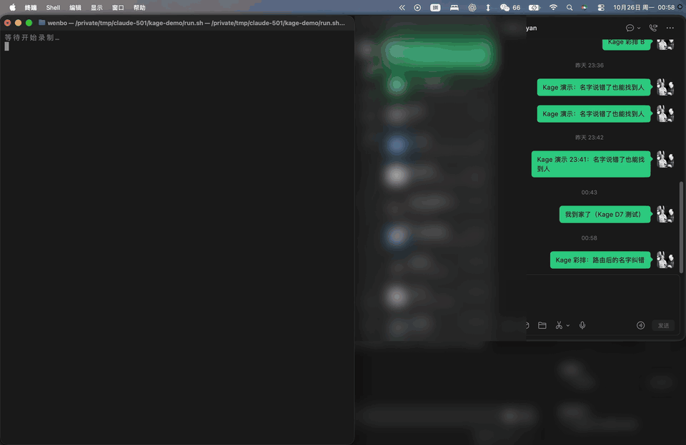
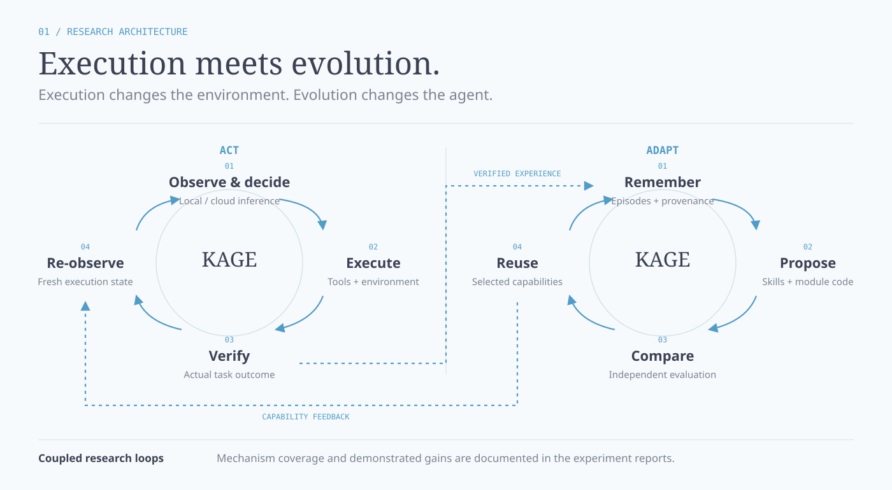
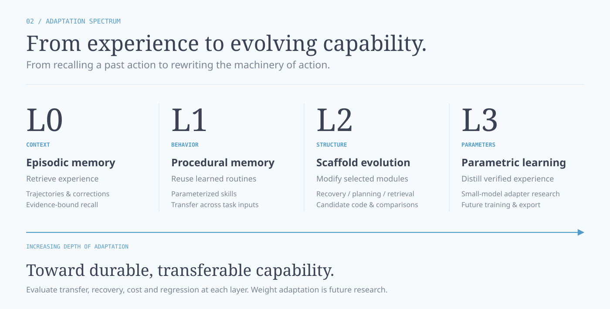

<p align="center"><a href="readme.md">English</a> · <strong>简体中文</strong></p>

<p align="center">
  <strong>迈向可自进化的通用电脑 Agent</strong><br>
  电脑操作 · 持续学习 · 程序性记忆 · Agent 自修改
</p>

<p align="center">
  <a href="#迈向可自进化的个人-agent">项目愿景</a> ·
  <a href="#研究方向">研究方向</a> ·
  <a href="#体验浏览器教学流程">开始体验</a> ·
  <a href="#演示">演示</a> ·
  <a href="#最新进展2026-年-10-月">最新进展</a> ·
  <a href="#实验结果一个向老师学习的-4b-本地模型">实验结果</a> ·
  <a href="docs/report/kage-tech-report.md">技术报告</a> ·
  <a href="roadmap.md">路线图</a> ·
  <a href="docs/project-guide.zh-CN.md">完整指南</a>
</p>

## 演示

<p align="center">
  <a href="docs/assets/demo/kage-live-demo.mp4"></a><br>
  <em>实时运行，66 秒，未加速：本地 4B 模型操作日历、天气、知乎、计算器和微信（联系人名字说错时先找到正确的人、确认后再发）。点击看<a href="docs/assets/demo/kage-live-demo.mp4">高清视频</a>；教学闭环演示：<a href="docs/assets/demo/kage-demo.mp4">83 秒</a>。</em>
</p>

## 最新进展（2026 年 10 月）

- **日常桌面助手，命令行优先。** 按你平时的叫法打开软件（微信、飞书、vscode，20/20）；通过真实路径读改你打开的文档（11/11，只能改请求里点名的文件）；每天 12:30 从日历和提醒事项推送日程；列出并用本地模型总结未读邮件（10 封总结 10/10 无事实错误）；通过 [OpenCLI](https://github.com/jackwener/opencli) 在你已登录的 Chrome 里读网站。本机使用日志记录每次请求、Kage 做了什么、成没成功；失败后会问你是怎么做成的并记下来。（[D 阶段证据](evidence/reports/d0/analysis.md)）
- **先修接口，再教，最后巩固。** 观察里一个字段让网页设置题从 1/18 到 17/18；按行编辑的工具让 macOS 文本编辑从 4/18 到 17/18；老师规则放在系统提示里学生不用，放在任务旁边才会用。LoRA 巩固让学过的文件题 30/72 → 65/72，但没学过的写代码题 15/36 → 1/36：五组消融显示提升和遗忘来自同一批样本，换三个训练 seed 都复现。[论文 v0.8（PDF）](docs/paper/v0.8/paper.pdf)
- **预注册确认实验（全新冻结题）。** 18 道题在任何运行前写定并记哈希，各条件同一会话交错跑。按行工具让文本编辑再次从 3/18 到 18/18，第二个学生（Nemotron-3-Nano-4B）从 2/18 到 17/18。计算器规则：无规则 1/30、系统提示 6/30、任务旁 19/30、任务旁加先写计划 23/30。起作用的主要是规则放在哪，先写计划只多一点。同样的位置也让学生把规则用在不该用的地方（对照题 18/18 → 8/12）。（[证据](evidence/reports/g0-confirm/README.md)、[预注册](docs/plans/g0-confirm-prereg.md)）
- **通过辅助功能接口操作 macOS 原生应用。** 计算器、文本编辑、系统设置（只读）：19/30 → 41/45，并有可现场复现的“做错 → 老师写规则 → 新题做对”演示（[脚本](docs/report/demo-g0.md)）。

## 迈向可自进化的个人 Agent

<strong>Kage 探索能够操作电脑、从经验与教学中学习，并改进自身决策系统部分机制的 Agent。</strong>

项目的野心是跨浏览器、文件、文档和原生应用的通用电脑操作。经验应当积累为可迁移的能力，失败任务应当为下一次学习或修改提供依据。Kage 将<strong>电脑操作执行、持续适应与 Agent 脚手架演化</strong>连接到同一个实验系统中。

### 超越固定工具集合

研究路线从检索有用记忆，延伸到创建可执行技能、修改部分 Agent 模块，再到未来将经过验证的经验蒸馏进本地模型。每一层都面向更深的能力变化，改善 Agent 求解后续任务的方式。

### 以经验驱动改进

任务失败时，可以由人类或云端教师示范解法。目标学习链保留实际动作与验证结果，提取可复用知识，再用新任务检验收益。技能、源码修改与未来的权重更新作为不同机制分别评估。

### 在个人硬件上开展前沿实验

本地小模型与按需云端教学，为有限硬件上的自主性、迁移、自修改和资源消耗研究提供实际环境。长期目标是让 Agent 能够<strong>行动、学习，并重新设计自身部分问题求解机制</strong>。

## 研究方向

### 电脑操作与程序性记忆

- <strong>通用行动能力：</strong>连接浏览器 DOM 感知、原生 macOS 辅助功能接口与未来的视觉定位。在内容、布局和初始状态变化后，评估任务完成与恢复能力。
- <strong>将经验变成能力：</strong>把轨迹与纠正转化为参数化流程，检验发现、组合与新输入迁移，而不只重放原始示范。

### 自修改与失败驱动的改进

- <strong>演化 Agent 脚手架：</strong>在隔离环境中生成候选修改，加载实际修改后的代码，对比父版本与子版本行为。恢复模块试点已实现，更广泛的模块演化是下一方向。
- <strong>选择改进路径：</strong>研究何时检索记忆、修复技能、修改模块或请求教学。失败驱动的路由仍是计划实验，将在明确预算下与固定策略比较。

### 有限硬件上的持续学习

- <strong>本地与云端协作：</strong>本地小模型承担低成本执行，云端教师按需支持困难任务与候选生成。任务成功和外部帮助成本分别记录。
- <strong>从教师经验学习：</strong>先积累经过验证且多样的轨迹，再蒸馏到本地适配器或权重；将记忆、技能与未来的参数学习作为不同机制比较。

开发从一台<strong>16 GB 内存的 Apple Silicon Mac</strong>出发。目标是在有限资源下实现实际的能力增长，并为每一步保留可复现的实验证据。

## Kage 如何成长

### 执行与演化，两个时间尺度



<strong>行动 → 验证 → 记忆 → 学习 → 评估 → 复用</strong>

执行闭环观察环境、选择动作，并检查结果状态。演化闭环使用这些证据提出技能或模块修改，比较行为，并选择有用能力供后续复用。

存在可靠检查器时，验证与实际结果绑定，例如回读浏览器任务保存的数据。候选版本与来源信息将每项改进连接到对应经验及评估记录。

### 四层适应机制



| 层级 | 改变什么 | 预期作用 |
| :--- | :--- | :--- |
| L0 · 情景记忆 | 当前任务检索到的经验 | 从过往尝试中获得相关上下文 |
| L1 · 程序性记忆 | 可调用的执行技能 | 复用并迁移经过验证的流程 |
| L2 · 脚手架演化 | 部分规划、检索或恢复模块 | 改善求解与错误恢复方式 |
| L3 · 巩固 | 本地模型的 LoRA 适配器 | 带指导时的成功变成不再依赖上下文指导的能力 |

研究目标是实现<strong>持久、可迁移的能力增长</strong>，同时衡量任务成功、能力回退、延迟、token 与学习成本。L0–L2 已实现并评测；L3 是当前阶段（[计划](docs/plans/rsr-consolidation-2026-10-18.md)）：学生带着由老师示范提炼的操作指南重新做新变体，只保留验证通过且通过泄漏筛查的成功，删掉指南后训练；适配器只有在**不带指导**时于冻结评测集上超过原学生，才会启用。

## 实验结果：一个向老师学习的 4B 本地模型

实验在冻结基准 **Kage-Stream v1** 上进行：每条学习流 60 题，含 4 个在流中学习的任务族、2 个只用于评测的未学族、3 个只读负例族。本地学生是 Agents-A1-4B（Q4_K_M，llama.cpp），老师是 DeepSeek。每次失败后，老师示范一次，智能体把示范保存为经过验证的技能、轨迹记忆，或两者兼有。评测检查点关闭学习和求教。


| 组（2 个种子） | 学过的族，60 题后 | 未学族 | 负例 / 误用 |
| :--- | :---: | :---: | :---: |
| A0 原学生 | 14/48（29%） | 16/24 | 24/24 · 0 |
| A1 同预算用于重试 | 12/48（25%） | 10/24 | 24/24 · 0 |
| A3 轨迹记忆 | 42/48（88%） | 12/24 | 24/24 · 0 |
| A4 技能库 | 39/48（81%） | 14/24 | 24/24 · 0 |
| A4m 技能 + 记忆 | 43/48（90%） | 9/24 | 23/24 · 1 |
| A5 + 相关性门控 + 主动求教 | 43/48（90%） | 12/24 | 24/24 · 0 |
| **A6-fixed + 后台自练与技能维护** | **45/48（94%）** | 12/24 | 24/24 · 0 |
| A6 + 架构师演化技能选用策略 | 41/48（85%） | 9/24 | 24/24 · 0 |

证据支持的结论：

- **从示范学习有效。** 每个学习组都大幅领先原学生和重试基线（A4 对 A0：不一致对 25 比 0，p = 6e-8）。每组的教师花费约 0.07–0.20 美元。
- **技能、记忆、自练与主动求教在本基准上分不出高下。** 学习组之间的配对差异都不显著（p ≥ 0.065），而原学生在相同的重复运行之间本身就会相差 ±3 题。
- **相关性门控是必要的。** 没有门控时，无关的技能和示范会干扰学生做未学过的题。有门控后，陌生任务收到的请求与原学生完全相同，只读题也从未触发技能。
- **自修改需要稳健的验证。** 让 LLM 架构师改写技能选用策略，按单次验证启用了 6 个方案中的 2 个。其中一个撤销了门控，所以带架构师的组反而低于不带的组。

### 浏览器任务：检索到了却不照做

在 **Kage-Stream-Web**（填表、带隐藏行的发票总额、通知设置、带评分下限的酒店选择，以及一个只读负例；每题 8 步、每步一个页面动作）上，同一个学生从按标签记录的老师示范中学习。

| 题型（每类 6 道评测题） | 原学生，3 次重复 | 学习后（44 题，4 次运行） |
| :--- | :---: | :---: |
| 发票总额（先展开隐藏行） | 0、0、0 | 2、2、1、2 |
| 通知设置 | 1、1、1 | 0、0、1、1 |
| 带评分下限的酒店选择 | 2、4、3 | 3、3、3、2 |
| 两步表单（迁移题，从不学习） | 0、0、1 | 0、0、0、0 |
| 只读问题（负例） | 6、6、6 | 6、6、6、6 · 零误用 |

检索没问题：每道评测题的提示里都带着相关示范。问题在采纳：发票题里学生只有 1–2/6 次照做了“Show more rows”这一步；而另一道题的点击列表也带不出“只点状态不对的开关”这类规则。只有操作步骤字面一致的题型有提升。所以下一步先教规则（C3），再把带指导的成功巩固进权重（L3）。[分析](evidence/reports/c2/analysis.md)

### 在日常使用中学习

同样的闭环也跑在桌面应用里：每个任务结束给 👍/👎；👎 后可请老师重做（每天上限 $0.05）；验证过的成功在相关度够高时作为经验用于相似的新请求；用户离开时，Kage 在临时目录里练习老师根据真实文件任务出的变体，并汇报学到了什么。轨迹存在 `~/.kage/trajectories`（可查看、可删除、可关闭），约 1/10 的真实任务留作评测。

[桌面现场演示（66 秒）](docs/assets/demo/kage-live-demo.mp4) · [教学闭环演示（83 秒）](docs/assets/demo/kage-demo.mp4) · [技术报告](docs/report/kage-tech-report.md) · [相关工作](docs/report/related-work.md) · [原始证据与报告](evidence/README.md) · [工作日志](docs/worklog/2026-10-claude.md)

### 个人助手交互界面

Kage 通过二次元 macOS 助手呈现这套系统，支持 Live2D 表情、可选语音和可配置人格，为人与 Agent 的交互提供更有个人感的入口。以 Haru 为参考的封面是临时概念插画，未来角色可沿用这套[视觉风格](docs/assets/readme/VISUAL_STYLE.md)。

## 体验浏览器教学流程

示范任务、提取候选工作流，再用新输入重放。录制与直接重放<strong>不需要模型服务器或云端密钥</strong>。

<strong>环境要求：</strong>Apple Silicon macOS · Python 3.10+ · Node.js 18+ · Playwright Chromium。

<details>
<summary><strong>安装与启动</strong></summary>

<strong>1. 下载仓库并安装依赖。</strong>

```sh
git clone https://github.com/lemon5227/Kage.git
cd Kage
python3 -m venv .venv
source .venv/bin/activate
python -m pip install -r requirements.txt -r requirements-computer-use.txt
python -m playwright install chromium
```

<strong>2. 启动控制 API。</strong>

```sh
KAGE_MODE=control KAGE_BROWSER_PYTHON="$PWD/.venv/bin/python" \
  python -m uvicorn core.server:app --host 127.0.0.1 --port 12345
```

<strong>3. 另开终端，从仓库根目录启动 Launcher。</strong>

```sh
cd kage-avatar
npm install
npm run dev
```

打开 [Launcher](http://localhost:1420/launcher.html)，找到<strong>浏览器教学</strong>面板。

选择任务 → 启动专用浏览器 → 示范并保存 → 结束并验证 → 修改参数，在新页面重放。

完整桌面／语音启动、可选音频依赖、模型配置与教学证据路径见[配置指南](docs/project-guide.zh-CN.md#体验浏览器教学流程)。

</details>

<details>
<summary><strong>本地模型与云端配置</strong></summary>

配置文件：`~/.kage/config.json`。

| 配置项 | 用途 |
| :--- | :--- |
| `model.local_runtime` | 兼容的本地服务器与模型 |
| `model.cloud_api` | 云端服务配置 |
| `model.hybrid` | 可选路由 |

已验证的本地配置使用<strong>Agents-A1-4B Q4_K_M 与 llama.cpp</strong>；云端教学实验使用过<strong>DeepSeek</strong>。API 凭据放在仓库之外。

详见[配置说明](docs/project-guide.zh-CN.md#模型与云端配置)。云端回退与经过验证的学习是不同机制。

</details>

## 后续路线

- ✅ <strong>P0–P3、P5：</strong>基准、各学习臂、相关性门控、主动求教、后台演化、技术报告、演示视频。
- ✅ <strong>A · 日常使用中学习：</strong>消息卡片、👍/👎、本机轨迹库与脱敏导出、老师重做、经验复用、空闲自练。
- ✅ <strong>C · 浏览器题型与接口：</strong>冻结 Kage-Stream-Web；老师规则（发票 0/24 → 14/24）；接口消融（设置题 1/18 → 18/18）。
- ✅ <strong>R · 巩固：</strong>带指导重做 → LoRA（A100）；回放与补写推理五组消融（R3–R3e）。
- ✅ <strong>G0 · macOS 原生应用：</strong>辅助功能驱动、带检查器的桌面任务、让规则落到本题、现场演示。
- ✅ <strong>论文 v0.8</strong>（[PDF](docs/paper/v0.8/paper.pdf)）：预注册确认实验、第二个学生、LoRA 结果三个训练 seed（提升和遗忘三次都复现）。
- ⏳ <strong>D · 日常桌面助手</strong>（[任务卡](docs/plans/cards/D-desktop.md)）：打开软件 ✅、打开的文档 ✅、日程早报 ✅、邮件 ✅、OpenCLI 网站 ✅（B站；知乎/小红书待登录）、微信截图 + 本地文字识别（进行中）、现场演示视频 ✅、arXiv。

<strong>这个项目是怎么做的：</strong>Claude Code 负责规划实验、写任务卡、审查每一处改动和结果；定义清楚的实现工作交给作为独立 Claude Code 进程运行的 DeepSeek-V4.1-Flash 执行器（[deepseek-agent](https://github.com/lemon5227/deepseek-agent)）；实验跑在 Kaggle 免费 T4 上，老师花费走 $4 总账本。每一步都记录在[工作日志](docs/worklog/2026-10-claude.md)。

[路线图与当前状态（执行入口）](roadmap.md) · [任务书](docs/plans/tasks-2026-10-14.md) · [方案：自进化、主动交互的 Agent](docs/plans/self-evolving-proactive-agent-2026-10-14.md) · [Kaggle 运行手册](docs/development/kaggle-runbook.md)

## 深入了解

| 入口 | 内容 |
| :--- | :--- |
| [项目洞察与经验教训](docs/insights.md) | 实验教会了我们什么：现象、证据、根因、解决办法 |
| [完整项目指南](docs/project-guide.zh-CN.md) | 详细研究背景、安装配置与实现边界 |
| [实验档案](docs/experiments/README.md) | 方法、结果、失败与复现证据 |
| [视觉风格说明](docs/assets/readme/VISUAL_STYLE.md) | 陪伴插画方向与后续人物更换 |
| [问题与建议](https://github.com/lemon5227/Kage/issues) | 反馈、提案与协作 |

---

MIT 许可证 · [优化历史](docs/optimization_history.md)
