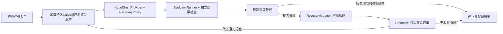

# G1 首包：实际调用链与最小接线

依据根roadmap的G1规格；基线f276fc8。行为目标：连续文件/代码任务的外部能力失败自动触发recovery候选，隔离验证晋级，下一任务/新进程从持久状态加载；故障禁用版本而不重放当前任务副作用。首轮冻结已有技能，唯一可改对象recovery。

复用已有search的有限候选/状态模式、Mutator、Promoter、runner、Journal、BudgetTracker、RecoveryPolicy和SkillCatalog。不再造数据库/评分器/候选格式。

缺失连接：连续入口的自动失败分类与白名单反馈；validation独立split支持；active+最后验证父版本的持久状态与加载校验；坏版本禁用和下一任务回退；总候选/运行计数跨重启保持。现有`Promoter.compare`仅dev晋级，历史脚本手写诊断且test参与根激活，不直接照搬。

首包固定边界：最多2候选、每候选最多3格式尝试/总6教师请求；开发/验证共12次真实运行，每次6本地请求、5循环步、150秒，单kernel step消费一条完整chain。工具动作上限须在实际链确认/门控，不以loop次数冒称动作数。教师3000输出/12000请求字节，费用上限计划0.03美元；新增付费调用在授权确认前不执行。开发输入和隔离validation预注册，test只在锁定active后报告，不参与晋级；最终G3不在此包启动。

先以真实runner/Promoter接口和可控模型边界验证自动触发、拒绝、重启加载、坏digest/运行故障有界回退及反馈隔离；这些是工程证据。真实生成与新输入调用须另有连续模型证据，不能把可控生成回归计作G1成长通过。记录父子digest、来源trace、验证决策、实际加载/调用与费用；无收益/无授权/限额停止，不自动延伸支撑包。
