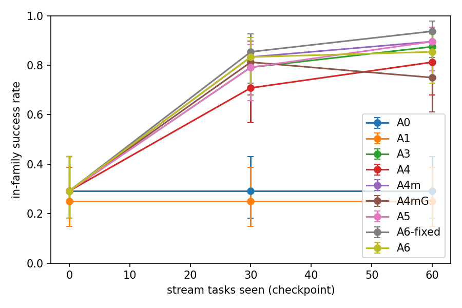

# Kage: A Small Local Agent That Learns From a Teacher, Knows What It Does Not Know, and Evolves in the Background

*Technical report (W6-2), 2026-10-16.
Every number comes from a `stream_report` summary in `evidence/reports/<name>/summary.json` (e1, e1b, e1c, e2, e2b),
rebuilt from the raw runs in `evidence/kaggle/` by `scripts/experiments/rebuild_reports.py`. A0 replicate counts
come from the `checkpoints.jsonl` files of Kaggle runs v6 and v11. Paired tests are on in-family tasks.*

## Abstract

Kage runs a 4B-parameter model (Agents-A1-4B, Q4_K_M, llama.cpp) as a local agent that edits files to solve
programming tasks. When it fails, it asks a cloud teacher (DeepSeek) for a demonstration and turns that
demonstration into something reusable: a parameterised, sandbox-verified skill, a stored trajectory, or both.
On Kage-Stream v1, a frozen continual-learning benchmark of 4 learned task families, 2 held-out families and 3
negative (read-only) families, learning from demonstrations raises the student's in-family pass rate from 14/48
(29%) to 39–45/48 (81–94%) after a 60-task stream, against 12/48 (25%) for a budget-matched retry baseline, for
US$0.07–0.20 of teacher calls per arm over two seeds. Skill libraries were **not** better than plain trajectory
memory (A4 vs A3 at cp60: 5 vs 8 discordant in-family pairs, p = 0.58), and without a relevance gate the learned
knowledge distracted the student on held-out families. P3 addresses this with a relevance gate under which an
unfamiliar task sees exactly the raw student's request, replaces benchmark family labels with agent-side
clusters, adds competence-driven proactive help (A5) and background evolution (practice, skill repair, and an
architect that evolves the skill-selection policy, A6). In E-2 the gate removed held-out interference (held-out
scores back inside the raw student's run-to-run range, zero misuse) while in-family gains remained (A6-fixed
45/48, A5 43/48). Proactive help almost never triggered on this stream, background practice added no
significant gain, and the L2 architect, validated on ten noisy tasks, promoted policies that made things
slightly worse (41/48), one of which undid the gate.

## 1. Motivation

Small local models are cheap, private and always available, but weak. A self-improving agent should (1) notice
when it cannot do something, (2) get help at a bounded cost, (3) keep what it learned in a form that transfers to
new instances of the same kind of task, (4) not apply that knowledge where it does not belong, and (5) improve
further without the teacher, during idle time. Kage tests these claims with paired, pre-registered comparisons
on a benchmark where the hidden checker never reaches the agent.

## 2. System

Three loops share one competence model (`core/evolution/competence.py`, Beta posteriors per task group and per
skill):

1. **Execution loop** (`AgenticLoop` via `KageChainProvider`): at most 6 model calls, 5 steps, 12 tool actions,
   150 s per task. Tools: workspace file tools plus `skill_search` / `skill_call` over a candidate-private,
   digest-pinned skill catalog executed in a sandbox (Docker on the Mac, a subprocess on Kaggle).
2. **Learning loop** (`core/evolution/stream.py`): after a failed attempt (environment feedback "not passed",
   which a user would also give) the teacher solves the task from a clean state; the result is cached per task
   instance and shared by every arm, so cloud cost does not grow with the number of arms. A verified
   demonstration that wrote files is turned into
   - a **trajectory memory** entry (A3): the visible actions and truncated observations, retrieved by
     instruction similarity and prepended to the student's history; and/or
   - a **skill** (A4 family): the optimizer proposes one parameterised Python function with a JSON schema; it is
     accepted only if the student, using it, passes the source task (A4) and, in A4g/A4m, the two most recent
     earlier tasks of the same group, with one generalisation rewrite allowed.
3. **Evolution loop** (P3, `core/evolution/practice.py`, `l2_selection.py`): every 10 stream tasks, practise 6
   fresh variants of the groups nearest the learning frontier (local only), repair skills that failed twice in
   practice (accepted only if the repaired version passes those failures and two earlier successes), retire
   unused or harmful skills, and every 20 tasks let a cloud architect propose a new skill-selection policy.

**Relevance gate and agent-side clusters (P3, `core/evolution/relevance.py`).** Similarity is TF-IDF cosine
over instructions, with document frequencies only from instructions the agent has already seen. Tasks join the
cluster of their nearest earlier instruction (threshold 0.3); clusters replace the benchmark's family label in
every decision (competence, help, verification history, practice targets). A skill is shown only if the task is
close to an instruction the skill was verified on; a demonstration only if it is close to the stored one.
When nothing passes the gate the catalog is empty and the whole model request is byte-identical to the raw
student's (integration test `test_gated_real_chain_learns_and_keeps_unrelated_prompts_identical_to_a0`).

**Proactive help (A5).** Before trying, the agent asks for help if its cluster's posterior failure probability
exceeds the help cost (0.25) after at least two observations **and** nothing relevant is known; once it has
learned something relevant it tries first again. It stops asking in a cluster where two help events taught
nothing learnable (e.g. read-only demonstrations).

**L2 architect (A6).** A DeepSeek "architect" reads a scrubbed version archive with read-only `ls/cat/grep`
tools (current `select()` policy, per-task gate decisions, scores, failing traces) and proposes one
`select(instruction, skills)` module (≤ US$0.015 per proposal). Parent and child run the same fresh validation
tasks (a seed range disjoint from stream, practice and eval); the child becomes active only if no task
regresses and at least one improves. Every candidate is recorded in a version tree. A6-fixed keeps the
human-written rule.

## 3. Benchmark: Kage-Stream v1

Nine procedurally generated families with ≥3 instruction phrasings each and hidden unit-test checkers:
F1 subset selection (the old knapsack regression), F2 interval merge, F3 log aggregation, F4 CSV transform
(learned in the stream); F5 text normalisation, F6 config migration (evaluation only); negatives
`read_preserve`, `inspect_question`, `lookalike_readonly` (the correct behaviour is to not modify files).
Seeds are split into stream / calibration / eval / practice / validation ranges. Calibration put every
capability family's raw pass rate in [0.10, 0.50] (n = 10 each). The stream (60 tasks, two orders) and the
eval set (48 in-family + 24 held-out + 24 negative) were frozen before E-1 (sha256 in the worklog).

## 4. Experimental setup

Arms run the same stream, evaluation set and student budgets. Checkpoints at 0, 30 and 60 stream tasks
evaluate the current state with learning and help switched off. A0 (raw) and A1 (the same total local budget
spent on retries) never change state and are evaluated once; their single evaluation is reused for every
checkpoint and seed (four later A0 replicates quantify how optimistic that is, §5.4). Paired comparisons use the
exact McNemar test over the 24 in-family evaluation tasks × 2 seeds (48 pairs); the reports also list the test
over all evaluation tasks. Hardware: Kaggle T4 ×2 (llama.cpp b29c606e2, CUDA), up to 4 jobs in parallel;
infrastructure crashes are never scored (the job restarts and resumes from that task).

## 5. Results

*In-family success rate (24 tasks × 2 seeds) by checkpoint; error bars are 95% Wilson intervals. A0/A1 are
single evaluations drawn as constants.*

### 5.1 Learning from demonstrations works (E-1, H1 part 1)

| Arm | cp0 | cp30 | cp60 (in-family, of 48) |
|---|---|---|---|
| A0 raw student | 14 | 14 | 14 |
| A1 budget-matched retries | 12 | 12 | 12 |
| A3 trajectory memory | 14 | 38 | **42** |
| A4 skill library | 14 | 34 | **39** |

A4 vs A0 at cp60: 25 vs 0 discordant pairs, p = 6e-8; A4 vs A1: 27 vs 0, p = 1.5e-8. The F1 knapsack regression
recovered from 0/12 to 11/12 (A4) and 10/12 (A3). Negatives: 24/24, no skill misuse.

### 5.2 Skills are not better than trajectory memory (E-1, E-1b, E-1c; H1 part 2)

A4 vs A3 at cp60: 5 vs 8, p = 0.58. Diagnosis found that the skill preview was alphabetical and hid the matching
skill as the library grew (all 8 in-family cp60 failures). Post-hoc fixes, reported as such:

| Arm (post-hoc) | Change | cp60 in-family | vs A3 at cp60 |
|---|---|---|---|
| A4r | relevance-ranked preview | 38/48 | 6:10, p = 0.45 |
| A4g | + verification on earlier same-family tasks, one generalisation rewrite | 40/48 | 6:8, p = 0.79 |
| A4m | A4g + trajectory memory | 43/48 | 6:5, p = 1 |

Each of them is far above the raw student (vs A0 at cp60: A4r 25:1, A4g 29:3, A4m 30:1; all p < 1e-5).

The fixes made the student actually use its skills, but pass rates did not follow: on this benchmark a
verified skill and a verified demonstration carry about the same information for a 4B student.

### 5.3 Learned knowledge interferes with unfamiliar tasks (E-1c)

Held-out families F5/F6 (24 tasks), cp0 → cp60: A4 16 → 14, A3 16 → 12, A4r 16 → 9, A4m 16 → 9, A4g 16 → 6, with
no skill calls on these tasks. The student was distracted by irrelevant skills and weakly matched
demonstrations in its prompt. This motivated the relevance gate (§2).

### 5.4 Relevance gate, proactive help and background evolution (E-2, E-2b)

| Arm | cp60 in-family (/48) | held-out (/24) | negatives / misuse | teacher calls (2 seeds) |
|---|---|---|---|---|
| A4m (no gate, E-1c) | 43 | 9 | 23/24, 1 | 26 |
| A4mG = A4m + gate + clusters | 36 | 13 | 24/24, 0 | 25 |
| A5 = A4mG + proactive help | 43 | 12 | 24/24, 0 | 29 |
| A6-fixed = A5 + practice and maintenance | 45 | 12 | 24/24, 0 | 23 |
| A6 = A6-fixed + L2 architect (E-2b) | 41 | 9 | 24/24, 0 | 21 |

None of the paired in-family differences among these arms is significant (A4mG vs A4m 2:9, p = 0.065; A5 vs
A4mG 9:2, p = 0.065; A6-fixed vs A5 3:1, p = 0.62; A6 vs A6-fixed 1:5, p = 0.22). A4mG and A5 differ only in a
help policy that fired once, yet differ by 7/48: each arm learns its own skills, and A4mG's log-aggregation
skill was wrong in both seeds (10 of its 12 failures).

**Run-to-run variance.** The student samples at temperature 0.7, so identical requests can pass or fail. Four
same-model evaluations of the raw student (A0) gave 7, 10, 13 and 7 of 24 in-family tasks and 8, 5, 8 and 6 of 12
held-out tasks per seed. Treating A0's single evaluation as a constant (as in E-1) makes its paired p-values
optimistic; the learning-vs-raw gap (≈ 40% vs ≈ 85–94%) is far larger than this variance, but the gaps between
learning variants are not.

**Gate (H4).** Recomputed from each arm's final state, the gated arms injected no skill and no demonstration on
any of the 48 held-out evaluations and never called a skill there; held-out scores (≈ 6/12 per seed) lie inside
the raw student's range (5–8/12), while the ungated A4m (4.5/12) lies below it. On in-family tasks the gate never
withheld the relevant skill or demonstration. Agent-side clusters: 21 clusters for 14 (family, seed) pairs,
100% pure; a family's different phrasings were sometimes split.

**Proactive help (H2).** A5 asked before attempting only once in 120 stream tasks. After the first failure in a
new cluster the after-failure help already teaches something relevant, and the policy then tries first, so the
"low competence and nothing relevant known" state rarely persists. On this benchmark the mechanism has almost
no room to act; H2 is untested rather than refuted.

**Background evolution and L2 (H3).** Practice ran 72 tasks per arm (A6-fixed 56 passed; A6 in E-2b 66). After a
fix that told the architect its turn budget (in E-2 it spent all 8 turns reading files), it proposed in 6/6
rounds at US$0.004–0.006 each and 2 proposals were promoted, each because 1 of ~10 validation tasks improved
with no regression. One promoted policy lowered the similarity threshold from 0.3 to 0.1, which re-admits weakly
related skills; A6 then scored below A6-fixed on both in-family and held-out tasks. With a stochastic student,
single-run validation on ten tasks selects noise.

## 6. Negative results and threats to validity

- Skill extraction did not beat memory (§5.2); improvements after E-1 were found by looking at E-1 results.
- A0/A1 are evaluated once and reused at every checkpoint and seed, which makes their paired p-values
  optimistic; four A0 replicates span 7–13/24 in-family (§5.4).
- L2 promotion used one run per validation task; with this student's variance it promotes noise. Safer
  promotion needs repeated runs per task and validation items from unfamiliar task types.
- The TF-IDF gate works because benchmark instructions are templated (same-family ≥ 0.38 vs cross-family
  ≤ 0.25 on replay); free-form user tasks would need an embedding model.
- Two stream orders, 48 in-family evaluation tasks per checkpoint: small samples, wide confidence intervals.

## 7. Cost

Total teacher budget US$2.00 (global ledger, reserve-before-call); US$1.12 was spent over all experiments,
including void and repeated runs. Cloud spend per arm over two seeds (e2b summary): A3 $0.071, A4 $0.192,
A4m $0.203, A4mG $0.193, A5 $0.163, A6-fixed $0.186, A6 $0.090 (its stream reused more cached proposals), with
21–37 teacher calls per arm. Teacher demonstrations are cached per task and shared, so most arm cost is skill
proposals. Student execution, practice and evaluation run locally (Kaggle T4) at no API cost.

## 8. Related work

See `docs/report/related-work.md` (W6-1): skill libraries (Voyager), experience memory, self-evolving harnesses
(Meta-Harness, Huxley-Gödel Machine), self-practice curricula, proactive agents, distillation.
